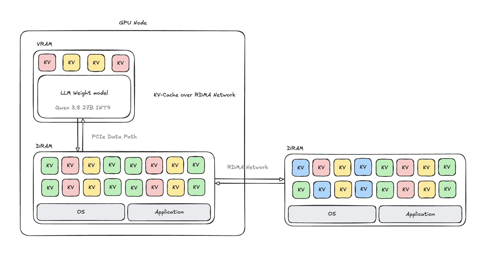
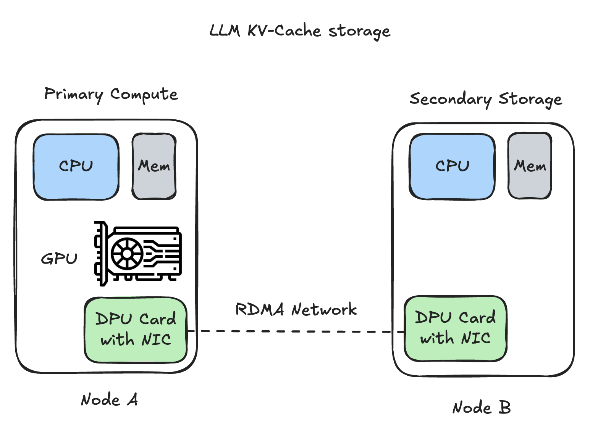

# MeshKV (`rdma-kv-store`)

**A small Rust object store for LLM KV-cache snapshots: opaque, immutable, checksummed objects kept as real files on a storage node and moved between two CPU hosts over RDMA (NVIDIA NIXL + UCX, RoCE).**



> **Status: research prototype.** The store, the RDMA transport and the integrity guarantees are implemented and tested on two hosts.
> Wiring a real inference engine to it (capture a KV snapshot, restore it, skip prefill) is **not** part of this crate and is **not** claimed here.

## Why

A single GPU holds a limited number of KV blocks in VRAM. Everything that does not fit has to be recomputed (prefill) or thrown away.
Spare DRAM and disk on a second machine, reachable over a fast RDMA link, can act as a second tier for those blocks. This crate is the **storage and transport layer** for that idea, kept deliberately independent of any inference engine:

* It stores **bytes + a small metadata record**. It never interprets tensors, tokenizers or attention state.
* An *engine adapter* (outside this crate) decides what a complete snapshot is, copies it from VRAM into CPU RAM, and hands MeshKV a buffer.
* MeshKV makes sure those bytes are published atomically, never modified, verified on every read, and moved over RDMA without a TCP data path.

## Architecture



| | Node A: primary compute | Node B: secondary storage |
|---|---|---|
| Role | GPU host that runs the model and holds the live KV cache | Holds the KV objects |
| Process | `kvstorectl` / your adapter via the `Client` library | `kvstored` |
| Memory | CPU staging buffer, registered with NIXL | Registered DRAM pool (default 8 × 64 MiB slots), then files |
| NIC | RoCE NIC (tested: NVIDIA BlueField-3 in plain NIC mode, 100 GbE) | same |

```text
node A (GPU host)                                      node B (storage host)
caller ─> Client ─ staging buffer (registered) ──RDMA WRITE / READ──> kvstored (registered DRAM slots)
             └───── control plane: length-prefixed JSON over TCP ─────┘            │ POSIX file I/O
                                                                                   ▼
                                                    <storage_root>/<namespace>/<xx>/<sha256(ns,key)>.obj
```

* **Data plane:** NIXL over UCX `rc_mlx5` (RoCE). The tested runs set `UCX_TLS=^tcp` so a silent fall-back to TCP is impossible.
* **Control plane:** a small TCP/JSON protocol (PUT/GET/EXISTS/DELETE/STATUS, auth token, slot grants).
* **CPU DRAM ↔ CPU DRAM only.** No GPUDirect RDMA, no GDS, no CUDA registration. GPU data must be staged in CPU RAM by the caller (the "PCIe data path" in the first diagram).

## Features

* **Immutable objects.** Same key + same content is an idempotent success; same key + different content is `CONFLICT`. Nothing is ever overwritten.
* **Atomic, durable publish.** write `.tmp-*` → `fsync` → `link()` (never replaces) → unlink tmp → `fsync` the directory. A PUT is acknowledged only after that.
* **End-to-end integrity.** The daemon re-hashes the whole file before serving it; the client re-hashes what it received (SHA-256). Corruption is reported as `CHECKSUM_MISMATCH`, never returned as data.
* **Bounded resources.** Fixed registered slot pool, quota, max object size, per-operation deadlines.
* **Failure behaviour.** A dropped connection or interrupted transfer never publishes a partial object; slots held by the dead connection are quarantined (default 60 s) before reuse. Orphan `.tmp-*` files are removed at start-up.
* **Typed errors.** `MISS` (absent key, not a failure), `CONFLICT`, `CHECKSUM_MISMATCH`, `TIMEOUT`, `UNAVAILABLE`, `INCOMPATIBLE`, `QUOTA_EXCEEDED`, `IO_ERROR`, `BAD_REQUEST`, `TOO_LARGE`, `UNAUTHORIZED`.
* **Opaque compatibility fingerprint.** The caller supplies a string (model revision, quantisation, KV layout, …); the store keeps it with the object and returns it, the caller compares.
* **Path safety.** The storage root is set only on the daemon; clients cannot choose paths. Namespaces are `[A-Za-z0-9._-]{1,64}`; keys are hashed.

### Object file format

```text
"RKVOBJ01" | u32 LE header_len | header JSON {namespace, key, meta{schema_version, fingerprint, format, size, sha256}, created_unix} | payload
```

## Quick start

Requirements: Linux x86_64, Rust (stable), a built NIXL install of the pinned revision (see below), a RoCE NIC on both hosts with a working GID, and a shared token file (mode `0600`) on both hosts.

```bash
# 1. build (NIXL_PREFIX = install tree of the tested NIXL revision)
NIXL_PREFIX=/path/to/nixl-install cargo build --release
cargo test --release            # file-store tests, no network needed

# 2. runtime environment (see env.sh.example)
. ./env.sh                      # sets LD_LIBRARY_PATH for libnixl / UCX plugins

# 3. storage node
./target/release/kvstored --listen 10.10.10.2:7471 --root /data/kv --token-file ~/kv-token \
    --ram-pool-mib 512 --chunk-mib 64 --quota-mib 2048

# 4. GPU node
UCX_TLS=^tcp ./target/release/kvstorectl smoke  --server 10.10.10.2:7471 --token-file ~/kv-token
UCX_TLS=^tcp ./target/release/kvstorectl put    --server 10.10.10.2:7471 --token-file ~/kv-token --ns demo --key k1 --size-mib 64
UCX_TLS=^tcp ./target/release/kvstorectl get    --server 10.10.10.2:7471 --token-file ~/kv-token --ns demo --key k1 --out /tmp/k1.bin
```

`kvstored --help` and `kvstorectl --help` list every flag (`--allow-delete`, `--namespaces`, `--fsync`, `--deadline-ms`, `--quarantine-ms`, …). Deleting is disabled unless the daemon is started with `--allow-delete`.

Tested against NIXL `2653767b80f080da4c375d663a308d444e63a8f1` through its C API (`libnixl_capi`), UCX 1.20. The FFI lives in `src/nixl_transport.rs`, the only module with `unsafe` besides the registered-buffer slices.

## Measured results (one run, two hosts, 100 GbE link)

Application-level numbers: **PUT includes `fsync` before the acknowledgement; GET includes whole-file verification on the storage node.** These are not raw wire speeds. One timed run per cell after one warm-up, unique keys, 0 errors and 0 silent corruptions in every cell.

| Cell | Object size | Count | In flight | PUT MiB/s | GET MiB/s | PUT mean | GET mean |
|---|---|---|---|---|---|---|---|
| A | 1 MiB | 1000 | 1 | 330 | 587 | 2.99 ms | 1.70 ms |
| B | 64 MiB | 20 | 1 | 402 | 622 | 138 ms | 102 ms |
| C | 64 MiB | 20 | 4 | 1002 | 2213 | 221 ms | 111 ms |

Context: the NIC sits in a PCIe Gen4 x4 slot, which caps the host-side path at roughly 50 Gb/s, below the 100 GbE link. NIC byte counters were consistent with the application bytes moved (RDMA payload, no TCP fallback observed). The full report and raw CSVs are in the `local-llm` project that hosts this experiment; they are not repeated here.

## Tests

* `cargo test --release`: six file-store tests (1 MiB PUT/GET and the real file on disk, duplicate idempotent / conflict, corrupt and truncated file, restart and orphan clean-up, names / quota / size / single-owner root, bad declared checksum).
* `tests/scripts/gate2_*.sh`: two-host checks (multi-chunk, interrupted transfer, server-side corruption, daemon restart, hung daemon → bounded `TIMEOUT`, 4 operations in flight).
* `tests/scripts/final_benchmark.py`: the single measurement behind the table above.

## Repository layout

```text
src/lib.rs             public API
src/client.rs          Client: staging buffer, PUT/GET, client-side verification
src/server.rs          kvstored: connections, slot pool, quarantine, deadlines
src/nixl_transport.rs  hand-written FFI over libnixl_capi (RDMA WRITE / READ)
src/file_store.rs      immutable file objects, atomic publish, quota, recovery
src/object.rs          object header / metadata, checksums
src/protocol.rs        control-plane frames
src/bin/               kvstored, kvstorectl
tests/                 file-store tests and two-host scripts
image/README/          diagrams used in this README
```

## Security boundary

A single shared token (constant-time compare) on a private link and an optional namespace allow-list. This is **not** per-user isolation: a caller-supplied namespace is not authentication. Multi-user use needs identity supplied by a trusted gateway, which is not implemented. A storage root under `/srv/llm-models` or `/mnt/node2-models` is refused by design.

## Limitations

* One storage daemon, one root, one NIXL agent per process; NIXL calls are serialised by a process-wide lock.
* Whole-file SHA-256 on every GET costs one extra sequential read on the storage node.
* No compression, replication, eviction, tiering or restore-into-engine logic.
* Measured on one pair of hosts; numbers will differ on other hardware.

## License

MIT. See [LICENSE](LICENSE).
